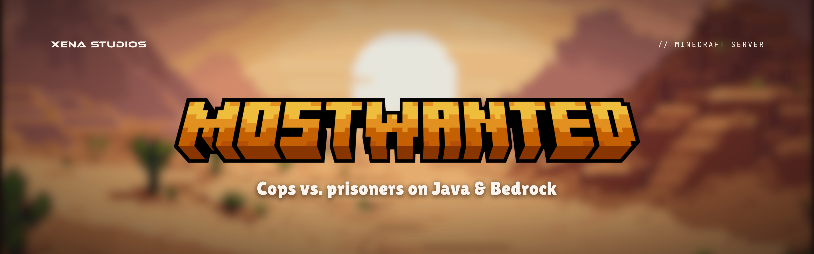

**Cops vs. prisoners on Java & Bedrock.**

MostWanted is a Jailbreak-style Minecraft server by [Xena Studios](https://xenastudios.co). Break out, rob the town, and stay ahead of the guards. Or be the guard who brings them back.

In development: the server isn't open yet. It will be at `play.mostwantedmc.com`.

## What's here

| Folder | What it is |
| --- | --- |
| [`core/`](core/) | MostWanted, the game plugin: every system the server runs |
| [`common/`](common/) | The database tables and message style, shared by core and backend |
| [`backend/`](backend/) | The website API and the Discord bot, in one Java app |
| [`website/`](website/) | mostwantedmc.com, with the store built in (Astro, Tebex) |
| [`pack/`](pack/) | The resource pack: item textures, published by CI |
| [`server/`](server/) | The game server: pinned plugins, scripts, configs, the eggs and the panel setup |
| [`brand/`](brand/) | The logo, key art and icons |
| [`tools/playtest/`](tools/playtest/) | Playtest bots, and a test map to walk around |
| `build-logic/`, `scripts/` | Gradle conventions; boot tests, changelogs and the new-Minecraft check |

## Design docs

| Doc | What's in it |
| --- | --- |
| [Vision](docs/01-vision.md) | What the server is and who it's for |
| [Gameplay](docs/02-gameplay.md) | Teams, escapes, robberies, arrests, riots, guns, economy |
| [Features](docs/03-features.md) | The backlog: must-have, nice-to-have, later |
| [Tech](docs/04-tech.md) | The stack, hosting, what we build, and how core stays fast |
| [Decisions](docs/05-open-questions.md) | What's decided, and what's still open |
| [Resource pack](docs/06-resource-pack.md) | Custom items on Java and Bedrock |
| [Server stack](docs/07-server-stack.md) | Every plugin we install, and why |
| [Website](docs/08-website.md) | The site, accounts, the API and player stats |
| [Brand](docs/09-brand.md) | Colours, messages, scoreboard, menus, logo |
| [Discord](docs/10-discord-bot.md) | The Discord server, the app and the bot |
| [Store](docs/11-store.md) | What's sold, how checkout works, setting up Tebex |
| [Launch](docs/12-launch.md) | From a fresh VPS to players joining, with backups and rollback |

## Building

Needs a JDK 25.

```sh
./gradlew build                # build and test everything, into <module>/build/libs/
./gradlew :core:runServer      # a Paper server with the plugin (needs PostgreSQL: see core/README.md)
```

## Status

**Built:** escapes, robberies, arrests, riots, guns, shops, menus, cosmetics and leaderboards, plus the website, store, API and Discord bot.

**Next:** the map, then launch on our netcup VPS, run with Calagopus ([launch steps](docs/12-launch.md)).

## Contributing

[CONTRIBUTING.md](CONTRIBUTING.md) covers tests, the rules a change keeps, pull requests and releases. For bugs and ideas, [open an issue](https://github.com/xena-studios/mostwanted/issues/new/choose); for help, see [SUPPORT.md](SUPPORT.md); report security problems privately, as [SECURITY.md](SECURITY.md) describes.

## Licence

[GPL-3.0-only](LICENSE).
