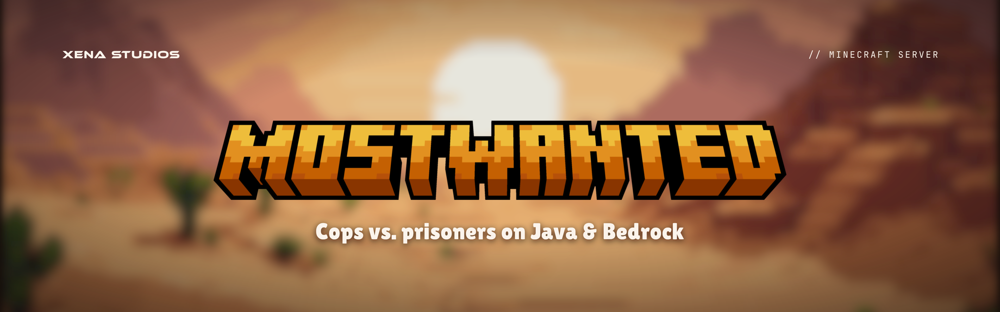

**Cops vs. prisoners on Java & Bedrock.**

MostWanted is a Jailbreak-style Minecraft server by [Xena Studios](https://xenastudios.co). Break out, rob the town, and stay ahead of the guards. Or be the guard who brings them back.

In development: the server isn't open yet. It will be at `play.mostwantedmc.com`.

This repo holds everything the server needs: the game plugin, its build and CI, and the design docs.

## What's here

```
core/          MostWanted, the game plugin: every system the server runs
common/        the database tables and message style, shared by core and backend
website/       the website, with the store built in (Astro, Tebex)
resource-pack/ source art and models for the custom items
server/        the game server: pinned plugins, install and start scripts, configs (no secrets)
backend/       the website API and the Discord bot in one Java app, and the Discord server's setup script
brand/         the logo, key art and icons
build-logic/   the Gradle conventions every module applies
docs/          the design: gameplay, tech, server stack, decisions
ideas/         raw ideas and name candidates
scripts/       boot tests, changelogs and the new-Minecraft check
```

| Doc | What's in it |
| --- | --- |
| [`docs/01-vision.md`](docs/01-vision.md) | What the server is, who it's for, and what makes it different |
| [`docs/02-gameplay.md`](docs/02-gameplay.md) | Jailbreak-style loop: teams, escapes, robberies, arrests, riots, guns, economy |
| [`docs/03-features.md`](docs/03-features.md) | Feature backlog, sorted into must-have / nice-to-have / later |
| [`docs/04-tech.md`](docs/04-tech.md) | Decided stack: server software, hosting, what we build, build order |
| [`docs/05-open-questions.md`](docs/05-open-questions.md) | Decisions made, and the ones still open |
| [`docs/06-resource-pack.md`](docs/06-resource-pack.md) | Custom textures and items on Java + Bedrock |
| [`docs/07-server-stack.md`](docs/07-server-stack.md) | Install list: server software, every plugin + version, start command, config |
| [`docs/08-website.md`](docs/08-website.md) | The website and store: Astro, Cloudflare, Tebex, what we sell |
| [`docs/09-brand.md`](docs/09-brand.md) | The look: orange `#ff9933`, desert theme, palette and logo style |
| [`docs/10-discord-bot.md`](docs/10-discord-bot.md) | Discord: the server's layout, the app, and what the bot does |
| [`ideas/names.md`](ideas/names.md) | Server name candidates |

## Building

Needs a JDK 25.

```sh
./gradlew build                # every plugin, tested, into <module>/build/libs/
./gradlew :core:runServer      # a Paper server with the plugin
```

[CONTRIBUTING.md](CONTRIBUTING.md) has the rest: tests, boot checks, the rules a change keeps, pull requests and releases.

## Status

Planning done, plugin skeleton building. Next: the server foundation and the core game loop ([build order](docs/04-tech.md#build-order)).

## Help

- **Bugs and ideas:** [open an issue](https://github.com/xena-studios/mostwanted/issues/new/choose).
- **Security problems:** privately, as [SECURITY.md](SECURITY.md) describes.
- **Anything else:** [contact@xenastudios.co](mailto:contact@xenastudios.co).

Everyone taking part follows the [code of conduct](CODE_OF_CONDUCT.md).

## Licence

GPL-3.0-only: the GNU General Public License, version 3 only, not later versions. See [LICENSE](LICENSE).
