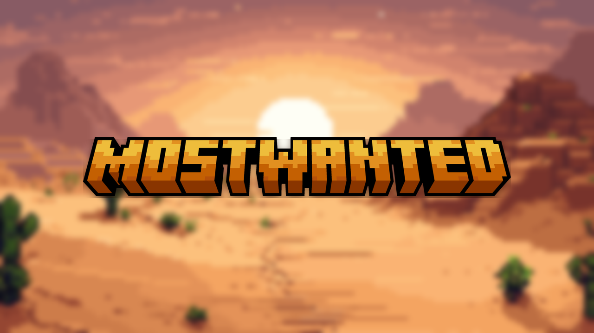

# Brand

MostWanted's logo and images. The rules (colours, naming, the in-game palette) are in [docs/09-brand.md](../docs/09-brand.md). MostWanted is also a product brand in [xena-studios/brand](https://github.com/xena-studios/brand#mostwanted), which makes the README banner (`.github/assets/banner.png`) and the GitHub social preview from these sources.

**The look:** the pixel-art desert, blurred, with the chunky orange logo centred on top.

## Sources

Edit these; everything in `out/` is generated from them.

| File | What |
| --- | --- |
| [`source/logo-wordmark.png`](source/logo-wordmark.png) | MOSTWANTED, the full logo (2000×277, transparent) |
| [`source/logo-monogram.png`](source/logo-monogram.png) | MW, for square and small spaces (2000×1101, transparent) |
| [`source/desert.png`](source/desert.png) | The pixel-art desert at sunset (1280×720) |

## Generated

`python3 scripts/brand-assets.py` (needs Pillow) rebuilds these. Commit them with the source change.

| File | Use |
| --- | --- |
| [`out/background-1920x1080.png`](out/background-1920x1080.png) | The blurred desert with no logo: website hero background |
| [`out/key-art-1920x1080.png`](out/key-art-1920x1080.png) | Website hero, trailers, big banners |
| [`out/key-art-1280x720.png`](out/key-art-1280x720.png) | Video thumbnails, Minehut listing |
| [`out/og-1200x630.png`](out/og-1200x630.png) | Link previews (Discord, X, iMessage) |
| [`out/discord-banner-960x540.png`](out/discord-banner-960x540.png) | Discord server banner |
| [`out/icon-1024.png`](out/icon-1024.png), [`out/icon-512.png`](out/icon-512.png) | Profile pictures: Discord, TikTok, YouTube, store |
| [`out/apple-touch-icon-180.png`](out/apple-touch-icon-180.png), [`out/favicon-32.png`](out/favicon-32.png) | The website's iOS icon and favicon |
| [`out/server-icon.png`](out/server-icon.png) | The 64×64 `server-icon.png` the server shows in the multiplayer list |

