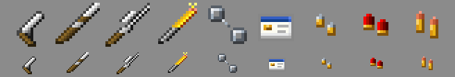

# Resource pack

The Java resource pack: the look of MostWanted's own items. Built by `build.py`, published by CI to the [`pack` release](https://github.com/xena-studios/mostwanted/releases/tag/pack), and sent to players by `core` as they join.



```
textures/<name>.png   one 16×16 texture per item (the source: edit these)
pack.png              the pack's icon
build.py              builds out/mostwanted-pack.zip and its SHA-1
```

```sh
python3 pack/build.py    # needs nothing but Python 3
```

## How items get their look

Each of our items is a vanilla item underneath (`guns.yml` says which), carrying a custom model data string such as `mostwanted:pistol` (core's `CustomItems`). The pack overrides each of those vanilla items: with our string it shows our model, otherwise the vanilla one. So:

- **Without the pack** (it failed to download, or a Bedrock player), items look like the vanilla items they're made from, never a missing texture. The game works the same.
- **A new item** needs a texture here named after it: `pistol`, `ammo_pistol`, `handcuffs`. `build.py` fails without one, and so does core's `CustomItemsTest`.
- **Changing an item's base** in `guns.yml` is picked up by `build.py`; nothing else to change.

Guns, the taser and handcuffs are held like tools (`item/handheld`); ammo and the keycard like flat items (`item/generated`).

## Style: it should look like it came with the game

- **Only Minecraft's colours.** Each material uses its vanilla shade ramp, taken from a vanilla texture: iron from the iron sword, wood from the stick, gold from the gold nugget, copper from the copper nugget, red from redstone, the taser's glow from the blaze rod, the keycard from paper and lapis, the handcuffs from the iron nugget (chain iron).
- **Light from the top left.** Brightest pixels on the upper-left edge, the darkest shade along the lower-right edge as the outline. Iron's outline is `#181818`, wood's `#281e0b`, as in vanilla.
- **Built like vanilla items.** Barrels are made like the iron sword's blade (the same cross-section, one pixel further left each row), stocks and grips like the stick, ammo like nuggets.
- **16×16**, no anti-aliasing, no semi-transparent pixels.

[Blockbench](https://www.blockbench.net) or any pixel editor works; keep the file names.

## Bedrock

Bedrock players reach us through Minehut's Geyser, which uses its own pack format. Whether an external server can give Minehut a Bedrock pack is still an open question ([docs/06-resource-pack.md](../docs/06-resource-pack.md)). Until then Bedrock players see the vanilla base items.
